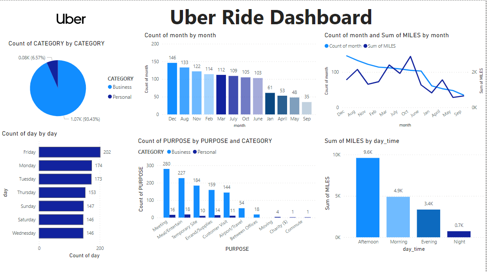

# Uber Rides Demand & Efficiency Analytics

A production-style exploratory analysis of Uber ride logs focused on **demand peaks**, **operational efficiency**, and **actionable business insights**. Instead of stopping at “pretty charts”, this project engineers features (timestamps, efficiency), flags anomalies that distort KPIs, and builds a stakeholder-ready dashboard view.

The end result is an analysis you could hand to an ops/strategy teammate and immediately discuss:
- when demand pressure is highest,
- whether rides are getting slower or faster over time,
- and which segments (Business vs Personal) behave differently.

## Author
**Mrinal Maurya**

## About Me
I’m a data analytics enthusiast focused on turning messy, real-world data into decisions. I enjoy feature engineering, exploratory analysis, and translating results into clear recommendations that an operations or product team can act on. I’m also a problem-solver by training and currently associated with **IIT Ropar**.

## Problem Statement
Rideshare operations depend on timing. Two weeks with the same ride count can have very different cost/revenue profiles if one week contains longer trips, worse congestion, or more anomalous rides.

This project answers:
- **When is demand consistently peaking?** (peak hours + peak days)
- **What does a “typical” ride look like?** (median duration, not average)
- **Where does efficiency degrade?** (miles/min and speed proxies)
- **Which rides should be reviewed?** (unusually long/short or suspiciously fast/slow)
- **Are we trending up, down, or shifting?** (monthly + weekly trends)

## Dataset
Files:
- `UberDataset.csv`: raw rides log
- `UberDatasetCleaned.csv`: cleaned/feature-ready version used by the enhanced notebook

Key fields used:
- Time: `start_date`, `start_hour`, `start_minute` (engineered into `start_dt`)
- Distance: `MILES`
- Segment: `CATEGORY` (Business / Personal), `PURPOSE`
- Derived metrics: `duration` (minutes), `miles_per_min`, `speed`

## Preprocessing (what changed and why)
The cleaning pipeline (supported for both raw and cleaned schemas) makes the data analysis-ready:
- Converts start/end timestamps to usable date/time components
- Fills missing `PURPOSE` values (forward-fill) to avoid losing otherwise valid rides
- Computes `duration` (minutes)
- Engineers `start_dt` for resampling and trend analysis
- Engineers `miles_per_min` as an explainable efficiency proxy
- Standardizes day-of-week ordering for consistent charts

## Key Insights (from this dataset)
These are not generic “Uber is busy on weekends” statements—these come directly from the computed results:
- **Peak demand concentrates in late afternoon.** The busiest hours are **15:00 (97 trips)**, followed by **17:00–18:00 (94 trips each)**.
- **Friday is the dominant demand day** with **201 trips**, making it the clearest weekly planning anchor.
- **The dataset is overwhelmingly Business usage**: **~93.4% Business vs ~6.6% Personal** by ride share.
- **Typical trips are short.** Median duration is **16 minutes**, but the top 10% exceed **41 minutes**—long-tail rides materially distort averages.
- **Outliers are common enough to matter.** The anomaly rules flag **57 unusually long trips** and **66 suspiciously high-efficiency trips** (often data issues or highway segments).
- **Seasonality exists.** The peak month for ride volume is **2016-12**, worth investigating for travel/holiday effects.

## Business Recommendations
- **Staff and position drivers around 15:00–18:00** (and especially Fridays). That window is the best place to reduce pickup times and cancellations.
- **Track medians, not means** for duration and efficiency; medians represent “typical” operations while still allowing long-tail review as a separate workstream.
- **Treat anomaly tables as QA and ops feedback.** Long-duration/low-mile rides can indicate congestion or multi-stop patterns; very fast rides often indicate timestamp/GPS issues.
- **Pair ride counts with miles in weekly reviews.** A flat ride count with rising miles is a fundamentally different operational week.

## Visuals
- `Dashboard.png`: existing dashboard image
- `uber_enhanced.ipynb`: improved professional visualizations + a dashboard-style multi-plot summary

## Tech Stack
- Python (3.11 recommended)
- Pandas, NumPy
- Matplotlib, Seaborn
- Jupyter / IPython

## Project Structure
```
.
├─ uber_enhanced.ipynb              # New: structured, advanced analysis + dashboard summary
├─ uber.ipynb                       # Original notebook (kept for reference)
├─ src/
│  └─ uber_analytics.py             # New: reusable functions (loading/cleaning/features/peaks/anomalies/trends)
├─ UberDataset.csv
├─ UberDatasetCleaned.csv
├─ Dashboard.png
├─ Uber.pbix
├─ Uber_Rides_Data_Analysis_Documentation_and_Recommendations.pdf
├─ requirements.txt                 # New: minimal install set
└─ requirments.txt                  # Legacy: existing pinned environment export
```

## How to Run
```powershell
cd "d:\Uber-Rides-Data-Analysis-main\Uber-Rides-Data-Analysis-main"
python -m venv .venv
.\.venv\Scripts\Activate.ps1
pip install -r requirements.txt
jupyter notebook
```

Open `uber_enhanced.ipynb` and run cells top-to-bottom.

## Dashboard Preview

